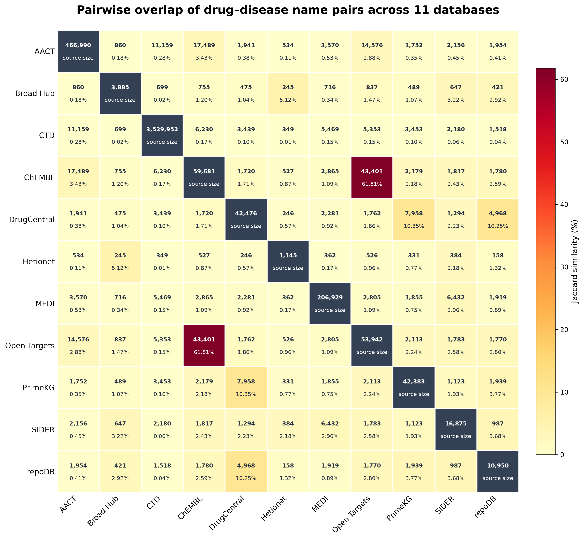
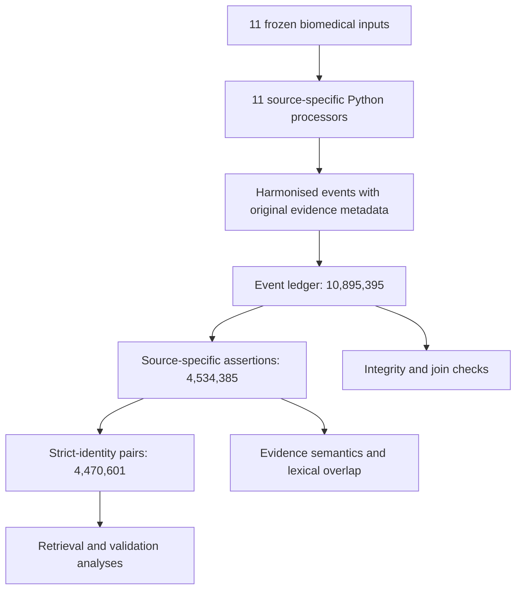

# Source-aware drug–disease relationship dataset and processing pipeline

**Muhammad Muneeb** · [GitHub](https://github.com/MuhammadMuneeb007) · [Project repository](https://github.com/MuhammadMuneeb007/drug-disease-mapping)

A reproducible, source-aware workflow for extracting, harmonising, integrating, and evaluating drug–disease relationships from **11 biomedical resources**. The project retains original source identifiers, relationship and evidence classes, and supporting-event provenance. It is intended for biomedical data integration, computational research, evidence-aware retrieval, and hypothesis generation—not as a catalogue of uniformly approved or clinically effective treatments.

**Manuscript:** *A source-aware drug–disease relationship dataset integrating public biomedical resources* — Muhammad Muneeb and David B. Ascher.

> **Published dataset (24 October 2026):** The validated eleven-source dataset is publicly available as **[Zenodo v3 (DOI: 10.5281/zenodo.23627171)](https://doi.org/10.5281/zenodo.23627171)**. The archive contains **14 files**, including the event, assertion and strict-identity pair datasets, integration and QC manifests, data dictionaries, source/licensing documentation, selected supplementary outputs, and SHA-256 checksums. The [concept DOI](https://doi.org/10.5281/zenodo.18308459) links all versions. This is the published **Zenodo v3** record for the internally validated eleven-source integration; a final tagged code release is not yet asserted. **Third-party data redistribution and CC BY 4.0 compatibility remain subject to rights review.**

## Contents

- [Validated dataset summary](#validated-dataset-summary)
- [Sources and versions](#sources-and-versions)
- [Data layers and schema](#data-layers-and-schema)
- [Installation](#installation)
- [Full processing workflow](#full-processing-workflow)
- [Analysis scripts](#analysis-scripts)
- [Technical validation](#technical-validation)
- [Licensing and redistribution](#licensing-and-redistribution)
- [Data availability and release provenance](#data-availability-and-release-provenance)
- [Citation and acknowledgements](#citation-and-acknowledgements)

## Validated dataset summary

These statistics are from the locked manuscript-analysis inputs processed and audited on **24 October 2026**.

| Measurement | Validated value |
|---|---:|
| Included original resources | **11** |
| Harmonised source evidence events | **10,895,395** |
| Distinct source-specific assertions | **4,534,385** |
| Additional supporting events represented by assertion counts | **6,361,010** |
| Strict-identity drug–disease pairs | **4,470,601** |
| Distinct conservatively normalised drug-name keys | **158,364** |
| Distinct conservatively normalised disease/condition-name keys | **72,563** |
| Distinct conservatively normalised drug–disease name pairs | **4,313,189** |
| Normalised-name pairs present in 2+ sources | **83,878 (1.945%)** |
| Potentially conflicting strict-identity pairs | **87** |
| Original relationship types / evidence types | **18 / 28** |
| Analytical evidence families | **14** |

**Interpretation:** Events, assertions, strict-identity pairs, and normalised-name pairs are *different counting units*. The 6,361,010 additional supporting events were retained in the event ledger and accounted for through assertion support counts; they are **not** 6.36 million deleted or independently validated biological observations. Conservatively equal drug/disease names do not establish chemical or ontology-level identity.

### Contributions of each source

| Source | Evidence events | Assertions | Additional supporting events |
|---|---:|---:|---:|
| AACT | 688,745 | 485,060 | 203,685 |
| Broad Drug Repurposing Hub | 3,892 | 3,885 | 7 |
| ChEMBL | 60,055 | 59,751 | 304 |
| CTD | 9,735,698 | 3,592,638 | 6,143,060 |
| DrugCentral | 42,515 | 42,479 | 36 |
| Hetionet | 1,145 | 1,145 | 0 |
| MEDI | 222,412 | 222,412 | 0 |
| Open Targets | 53,950 | 53,950 | 0 |
| PrimeKG | 42,631 | 42,631 | 0 |
| repoDB | 13,558 | 12,118 | 1,440 |
| SIDER | 30,794 | 18,316 | 12,478 |
| **Total** | **10,895,395** | **4,534,385** | **6,361,010** |

CTD's large reduction from evidence events to assertions mainly reflects multiple inferred-gene and publication-associated events underlying the same chemical–disease assertion. AACT similarly retains distinct trial-level contexts. The source-event ledger, rather than the assertion layer, should be used when those contexts are needed.

### Pairwise drug–disease pair overlap heatmap



*Pairwise drug–disease name-pair overlap across the eleven included databases.* The graphic summarises shared conservatively normalised drug–disease name pairs and pairwise Jaccard similarity. Lexical overlap does **not** establish ontology-level equivalence, independent evidence, or validated therapeutic efficacy. The [PNG figure](pairwise_drug_disease_pair_overlap_heatmap.png) is stored in the repository root; its generation code is [`Analysis_09_Cross_source_drug_disease_pair_ovelap_diagram.py`](Analysis_09_Cross_source_drug_disease_pair_ovelap_diagram.py). For reproducibility, consult the analysis scripts and deposited dataset version.

## Sources and versions

The included source processors write harmonised CSV files for **exactly eleven** resources. Source download/release labels are not automatically equivalent to the original acquisition timestamp.

| Resource | Inspected input / version | Processor | Primary source |
|---|---|---|---|
| AACT / ClinicalTrials.gov | Local archive labelled `aact_20260114` | [`aact.py`](aact.py) | [AACT](https://aact.ctti-clinicaltrials.org/) |
| Broad Drug Repurposing Hub | Annotation file labelled `20200324` | [`Broad.py`](Broad.py) | [Repurposing Hub](https://repo-hub.broadinstitute.org/repurposing) |
| ChEMBL | **ChEMBL 37** | [`chembl.py`](chembl.py) | [ChEMBL downloads](https://ftp.ebi.ac.uk/pub/databases/chembl/ChEMBLdb/releases/chembl_37/) |
| Comparative Toxicogenomics Database (CTD) | Chemical–disease report generated **2026-04-30** | [`ctd.py`](ctd.py) | [CTD](https://ctdbase.org/) |
| DrugCentral | Database version **56**, frozen extraction **2026-10-24** | [`drugcentral.py`](drugcentral.py) | [DrugCentral](https://drugcentral.org/download) |
| Hetionet | v1.0 | [`hetionet.py`](hetionet.py) | [Hetionet](https://github.com/hetio/hetionet) |
| MEDI | MEDI-2 (ICD and UMLS inputs) | [`MEDI.py`](MEDI.py) | [MEDI](https://www.vumc.org/wei-lab/medi) |
| Open Targets Platform | **26.03** | [`opentargets.py`](opentargets.py) | [Release directory](https://ftp.ebi.ac.uk/pub/databases/opentargets/platform/26.03/) |
| PrimeKG | Harvard Dataverse `kg.csv` snapshot | [`PrimeKG.py`](PrimeKG.py) | [PrimeKG dataset](https://doi.org/10.7910/DVN/IXA7BM) |
| repoDB | Local full export; exact upstream revision unconfirmed | [`repoDB.py`](repoDB.py) | [repoDB](https://unmtid-shinyapps.net/shiny/repodb/) |
| SIDER | SIDER 4.1 indication files | [`sider.py`](sider.py) | [SIDER](https://sideeffects.embl.de/) |

**Not included:** [`TTD.py`](TTD.py) and [`openFDA.py`](openFDA.py) are exploratory processors and do **not** contribute to the locked eleven-source integration. Do not add their outputs without a documented and revalidated change to the source manifest.

## Data layers and schema

The source-specific files share ten leading columns:

| Column | Meaning |
|---|---|
| `drug_name` | Source-derived drug, substance, chemical, or intervention label |
| `drug_identifier` | Reported drug identifier, if supplied |
| `drug_identifier_type` | Drug identifier namespace |
| `disease_or_condition_name` | Reported disease, condition, phenotype, or indication label |
| `disease_or_condition_identifier` | Reported condition identifier, if supplied |
| `disease_or_condition_identifier_type` | Condition identifier namespace |
| `relationship_type` | Original/harmonised relationship classification |
| `evidence_type` | Source-defined evidence classification |
| `source` | Contributing database |
| `internal_source` | Internal source or evidence subset |

Additional source-specific columns retain available trial IDs, PubMed IDs, inferred genes, original identifiers, clinical stages, source rows, and other provenance. Not every source has the same optional fields.

### Three complementary output representations

| File under `data/processed/` | Unit of analysis | Meaning |
|---|---|---|
| `ALL_INCLUDED_SOURCES_drug_disease_merged.csv` | **Evidence events** | Pre-deduplication **harmonised** source event ledger; this is *not* an untouched raw-source dump |
| `ALL_INCLUDED_SOURCES_drug_disease_deduplicated.csv` | **Source-specific assertions** | Unique 9-field source-semantic states, with supporting-event counts and preserved evidence links |
| `ALL_INCLUDED_SOURCES_drug_disease_source_collapsed.csv` | **Strict-identity pairs** | Exact agreement across the six represented drug/disease name, identifier and namespace fields; evidence and source support remain available |

The **assertion identity** uses the six drug/disease identity fields plus `relationship_type`, `evidence_type`, and `source`. **Strict-identity pairs** use the six identity fields alone. A separate descriptive lexical analysis lowercases, trims, and collapses whitespace in names; it does **not** resolve synonyms, stereoisomers, salts, drug classes, brand names, disease ontologies, or chemical equivalence.



## Installation

```bash
# Clone the project
 git clone git@github.com:MuhammadMuneeb007/drug-disease-mapping.git
 cd drug-disease-mapping

# Create an environment
 python3 -m venv .venv
 source .venv/bin/activate

# Dependencies used across the processors, merger, and analyses
 python -m pip install 'polars==1.44.1' tqdm pandas pyarrow duckdb requests psycopg2-binary rich numpy matplotlib
```

Python must have access to the **original compatible source files**, enough disk space for the event ledger and work partitions, and sufficient RAM. Several source processors assume project-relative raw files or an HPC-specific path. Check each processor's `--help` and existing source inventory before running. **On shared clusters, schedule large acquisition, merging, and QC work on a compute node rather than a login node.**

For the validated integration, the observed Polars version was **1.44.1**. Hash-derived IDs can be version-dependent. Use the recorded environment, source checksums, and the final tagged Git commit to reproduce an exact deposited release.

## Full processing workflow

### 1. Prepare the original source inputs

Obtain the correct source versions from the official publishers in accordance with their terms. The expected source locations include:

```text
data/raw/aact_20260114/aact_export.zip
data/raw/broad_repurposing/repurposing_drugs_20200324.txt
data/raw/chembl/chembl_37_sqlite.tar.gz
data/raw/ctd/CTD_chemicals_diseases.tsv.gz
data/raw/hetionet/hetionet-v1.0-nodes.tsv
data/raw/hetionet/hetionet-v1.0-edges.sif.gz
data/raw/medi/MEDI-2.csv
data/raw/medi/MEDI-2_UMLS.csv
data/raw/repodb/repodb_full_download.tsv
data/raw/sider/drug_names.tsv
data/raw/sider/meddra_all_indications.tsv.gz
```

Other inputs include the Open Targets 26.03 Parquet files, the PrimeKG `kg.csv` download and the frozen DrugCentral relationship snapshot. **These large upstream datasets are not bundled with the GitHub code**, and a successful installation does not automatically download or license them.

### 2. Process the eleven included sources

Run these scripts **only after their corresponding source inputs are available**. They can overwrite the relevant files under `data/processed/`. Check each script's source-specific options before rerunning a locked integration.

```bash
python aact.py
python Broad.py
python chembl.py
python ctd.py
python drugcentral.py --offline   # Reuses the frozen local DrugCentral snapshot
python hetionet.py
python MEDI.py
python opentargets.py --offline
python PrimeKG.py
python repoDB.py
python sider.py
```

The eleven files required by the merger must be present at these precise relative paths:

```text
data/processed/aact/aact_drug_disease.csv
data/processed/broad_repurposing/broad_repurposing_drug_disease.csv
data/processed/chembl_drug_disease.csv
data/processed/ctd_aggregate_chemical_disease.csv
data/processed/drugcentral_drug_disease.csv
data/processed/hetionet/hetionet_drug_disease.csv
data/processed/medi/medi_drug_disease.csv
data/processed/opentargets_drug_disease.csv
data/processed/primekg/primekg_drug_disease.csv
data/processed/repodb/repodb_drug_disease.csv
data/processed/sider/sider_drug_disease.csv
```

These are the input filenames hardcoded in [`Analysis_00_MergeDatabases.py`](Analysis_00_MergeDatabases.py); do not rename them or substitute raw archives. Some scripts use pinned input files by default and will fail rather than silently download missing data. `drugcentral.py` needs an existing snapshot for `--offline`; otherwise consult its PostgreSQL options.

### 3. Merge and preserve supporting events

**Warning: this step regenerates/replaces final integration outputs. Skip it when merely inspecting the validated frozen files.**

```bash
python Analysis_00_MergeDatabases.py --processed-dir data/processed
```

The merger validates eleven source inputs, writes the complete harmonised event ledger, constructs source-specific assertion and exact-identity pair views, and generates the manifest with counts and SHA-256 checksums. By default it expects the locked source counts; `--allow-count-drift` exists for deliberate exploratory runs and **must not** be used to claim reproduction of the published dataset.

### 4. Independently audit the merger

```bash
python Analysis_00C_MergeQuality.py \
  --processed-dir data/processed \
  --verify-hashes --verify-source-hashes
```

The auditor checks the available merged layers, source and output checksums, event support, pair identities, and potential semantic conflicts. Use the same Polars version and bucket count as the merger.

### 5. Run the technical-validation analyses

Run from the repository root after the merged files and manifest exist:

```bash
# S1–S7: source composition, relationships, overlap and name/identifier QC
python Analysis_01_Source_level_dataset_composition.py --save-tables
python Analysis_02_Evidence_type_distribution.py --save-tables
python Analysis_03_Relationship_type_distribution.py --save-tables
python Analysis_04_Unique_drug_coverage.py --save-tables
python Analysis_08_Cross_source_drug_disease_pair_overlap.py --save-tables
python Analysis_09_Cross_source_drug_disease_pair_ovelap_diagram.py
python Analysis_11_Drug_disease_identifier_completeness.py --save-tables
python Analysis_13_Excluded_source_analysis.py --save-tables

# S8–S10: worked example, comparator analysis, and selected indications
python Analysis_18_Worked_example_type2_diabetes_indication_use_case.py --save-tables
python Analysis_19_Benchmark_against_PrimeKG_Hetionet.py --save-tables
python Analysis_20_Positive_control_approved_indication_sanity_check.py --save-tables

# S11: build the FDA Orange Book ingredient reference, then evaluate coverage
python Analysis_23_WHO_EML_or_Approved_Drug_Coverage_make_reference.py \
  --products EOBZIP_2026_04.zip
python Analysis_23_WHO_EML_or_Approved_Drug_Coverage.py --save-tables
```

**Use the exact filenames as committed.** Some module docstrings refer to older filenames; the commands above use the current repository filenames. `Analysis_22_Ontology_normalised_cross_source_overlap.py` is an empty local placeholder in the inspected working directory, not a completed analytical step.

### 6. Review figures and tables

The **[committed heatmap PNG](pairwise_drug_disease_pair_overlap_heatmap.png)** is available at the repository root and is displayed above. The figure-generation script can also write plots under `figures/` and supporting tables under `tables/` when run locally; these generated directories are not necessarily committed to GitHub. The heatmap expresses **shared conservatively normalised drug–disease name-pair counts and pairwise Jaccard similarity**, not conditional row-overlap percentages. Reproduction should use the matching validated snapshot and documented scripts.

## Analysis scripts

| Script | Purpose |
|---|---|
| `Analysis_0.1_InspectFiles.py` | Inspect source and processed files |
| `Analysis_00_MergeDatabases.py` | Eleven-source integration, event ledger, assertion and pair generation |
| `Analysis_00C_MergeQuality.py` | Independent merger validation and hash integrity |
| `Analysis_01_Source_level_dataset_composition.py` | Source composition, counts, names, evidence support |
| `Analysis_02_Evidence_type_distribution.py` | Original evidence labels and analytical evidence families |
| `Analysis_03_Relationship_type_distribution.py` | Original relationship types and related summaries |
| `Analysis_04_Unique_drug_coverage.py` | Name-level drug, disease, and pair coverage |
| `Analysis_08_Cross_source_drug_disease_pair_overlap.py` | Source support and pairwise lexical overlap |
| `Analysis_09_Cross_source_drug_disease_pair_ovelap_diagram.py` | Heatmap and pairwise Jaccard visualisation |
| `Analysis_11_Drug_disease_identifier_completeness.py` | Identifier availability, namespace and mapping ambiguity |
| `Analysis_13_Excluded_source_analysis.py` | Source manifest, schema and name-quality checks |
| `Analysis_18_Worked_example_type2_diabetes_indication_use_case.py` | Type 2 diabetes retrieval example |
| `Analysis_19_Benchmark_against_PrimeKG_Hetionet.py` | Comparisons with PrimeKG and Hetionet |
| `Analysis_20_Positive_control_approved_indication_sanity_check.py` | Selected indication recovery controls |
| `Analysis_23_WHO_EML_or_Approved_Drug_Coverage_make_reference.py` | FDA Orange Book single-ingredient RX/OTC reference construction |
| `Analysis_23_WHO_EML_or_Approved_Drug_Coverage.py` | External reference drug-name coverage analysis |

The `analysiscode/` directory also holds source-oriented exploratory analyses. Not every script is required to generate the locked eleven-source dataset.

## Technical validation

The accompanying manuscript and supplementary analyses describe the following **completed analyses on the validated local snapshot**:

- **Event conservation:** 10,895,395 source events reconcile to 4,534,385 source-specific assertions with preserved supporting-event counts.
- **Integrity:** all **11 processed merger inputs** and **23 identified raw/snapshot files** passed comparison against recorded SHA-256 hashes.
- **Source relationships:** 18 original relationship types, 28 original evidence types, 14 broader analytical evidence families; labels are not interchangeable.
- **Identifier and name auditing:** source identifier namespaces, name multiplicity, identifier-shaped placeholders, and potential mapping conflicts were assessed without asserting global entity resolution.
- **Duplicate multiplicity and joins:** CTD retained inferred-gene source records; an AACT join-cardinality check covered **202,623 trials** with **0 mismatches** in the evaluated 688,745 intervention–condition combinations.
- **Source overlap:** **83,878** conservatively normalised name pairs occurred across at least two included databases; this is lexical recurrence, not independent confirmation.
- **Positive-control retrieval:** **20 of 20** selected known indication examples had at least one strict indication-oriented evidence event. This is a selected sanity check, **not** a population-level precision, specificity, or approval estimate.
- **FDA Orange Book active-ingredient-name coverage:** **1,467 / 1,543 (95.075%)** single-active-ingredient RX/OTC reference names were strictly matched. An additional **25** formulation-review cases and **51** unmatched names were not counted as covered; this is **name coverage**, not indication-specific validation.

Further external negative controls, manual semantic-adjudication precision estimates, and regulatory-status verification would provide stronger independent accuracy evidence; they are **not claimed as completed** by the analyses listed above.

## Licensing and redistribution

The repository [`LICENSE`](LICENSE) applies the **MIT licence to project-created source code**, not automatically to records obtained or derived from third-party biomedical sources. Public downloads do **not** by themselves confer permission to republish the integrated database under MIT, CC0, or another unrestricted data licence.

The following table reports the licensing statements and concerns documented in the **supplementary source-licensing assessment**. **This is an attribution/reuse summary, not a legal clearance opinion.** Verify the current provider terms and constituent-data rights for the actual release before distribution.

| Data source | Reported terms / licence | Conditions to check before redistributing integrated records |
|---|---|---|
| AACT / ClinicalTrials.gov | Public trial data; no blanket redistribution licence established for complete derivative compilation | Cite ClinicalTrials.gov/AACT; confirm constituent-data reuse rights |
| Broad Drug Repurposing Hub | CC BY 4.0 for published compound annotations; separate portal restrictions may apply | Attribution; commercial-use and redistribution scope |
| ChEMBL | **CC BY-SA 3.0 Unported** | Attribution and ShareAlike requirements for derived content |
| CTD | Source-specific data-use requirements | Attribution, linking, notification, redistribution authority; commercial terms |
| DrugCentral | **CC BY-SA 4.0** reported | Attribution and ShareAlike conditions |
| Hetionet | Original content reported as **CC0** | Check upstream-derived data and preserve relevant source citations |
| MEDI | **CC BY-NC-SA 3.0 Unported** | NonCommercial and ShareAlike obligations; review licence compatibility |
| Open Targets | Platform-level **CC0**, with third-party rights reservations | Confirm contributing-provider conditions |
| PrimeKG | Harvard Dataverse dataset reported **CC0 1.0** | Review underlying graph input/terminology rights and cite dataset |
| repoDB | **CC BY 4.0** reported | Attribution; review embedded DrugBank/UMLS and trial-derived rights |
| SIDER | **CC BY-SA 4.0** reported for indication data | Attribution, ShareAlike and underlying terminology rights |

**Rights review for the published Zenodo v3 dataset:** The public Zenodo record displays **CC BY 4.0**, but the eleven contributing sources have potentially incompatible conditions, including non-commercial and share-alike terms. The release documentation reports these terms; it does **not** establish blanket redistribution clearance. Preserve source attribution, obtain institutional/source-owner guidance, and if required correct access, licence metadata, or the released content using an authorised approach. **The MIT software licence applies to project-created code only.**

## Data availability and release provenance

- **Published validated dataset (Zenodo v3, 24 October 2026):** [DOI 10.5281/zenodo.23627171](https://doi.org/10.5281/zenodo.23627171)
- **All versions (concept DOI):** [10.5281/zenodo.18308459](https://doi.org/10.5281/zenodo.18308459)
- **Earlier versions:** [v1](https://doi.org/10.5281/zenodo.18308460) and [v2](https://doi.org/10.5281/zenodo.20569217)
- **Code:** [GitHub repository](https://github.com/MuhammadMuneeb007/drug-disease-mapping)
- **Frozen code tag / archived code DOI:** Not yet established in this README; do not substitute an audit-time checkout for a verified release tag.

The **14 deposited files** comprise three compressed CSV datasets (`ALL_INCLUDED_SOURCES_drug_disease_merged.csv.gz`, `ALL_INCLUDED_SOURCES_drug_disease_deduplicated.csv.gz`, and `ALL_INCLUDED_SOURCES_drug_disease_source_collapsed.csv.gz`) plus `ALL_INCLUDED_SOURCES_merge_summary.json`, `Analysis_00C_merge_quality_report.json`, `data_dictionary.csv`, `data_dictionary.md`, `data_dictionary_summary.json`, `source_manifest.csv`, `LICENSES_AND_REUSE.md`, `README_DATA_RELEASE.txt`, `release_manifest.json`, `checksums_sha256.txt`, and `supplementary_analysis_outputs.zip`.

These counts describe the validated eleven-source integration deposited as **Zenodo v3**. Use the `release_manifest.json` and `checksums_sha256.txt` in that record to check downloaded files. This repository contains code, documentation, and the heatmap preview; the multi-gigabyte integrated datasets belong in Zenodo rather than Git. Source-file modification timestamps are not proof of download dates, and recorded audit commits are not automatically an immutable code release.

**Licensing note:** The dataset record is public and lists CC BY 4.0, but third-party terms may limit redistribution of derived records; see the licence section above and the deposited `LICENSES_AND_REUSE.md`. A disclaimer by itself does not resolve licence compatibility.

## Citation and acknowledgements

### Cite this project

The manuscript is authored by **Muhammad Muneeb and David B. Ascher**:

> Muneeb, M. & Ascher, D. B. *A source-aware drug–disease relationship dataset integrating public biomedical resources*. Manuscript in preparation (2026). **Update with journal/DOI after publication.**

For dataset use, cite the **specific published version actually used**. The validated eleven-source dataset is **Zenodo v3**:

```bibtex
@dataset{muneeb_drug_disease_v3_2026,
  author    = {Muneeb, Muhammad},
  title     = {A source-aware drug--disease relationship dataset integrating public biomedical resources},
  year      = {2026},
  version   = {v3},
  publisher = {Zenodo},
  doi       = {10.5281/zenodo.23627171},
  url       = {https://doi.org/10.5281/zenodo.23627171}
}
```

### Cite the original resources

Using the integrated records also requires citing the relevant upstream data resources, their versions, and applicable licences. Key source publications include:

- **AACT:** Tasneem et al. (2012), *PLoS ONE*. [DOI: 10.1371/journal.pone.0033677](https://doi.org/10.1371/journal.pone.0033677)
- **ChEMBL:** Zdrazil et al. (2024), *Nucleic Acids Research*. [DOI: 10.1093/nar/gkad1004](https://doi.org/10.1093/nar/gkad1004)
- **CTD:** Davis et al., *Nucleic Acids Research*, 2025 update. [DOI: 10.1093/nar/gkae883](https://doi.org/10.1093/nar/gkae883)
- **DrugCentral:** Avram et al. (2023), *Nucleic Acids Research*. [DOI: 10.1093/nar/gkac1085](https://doi.org/10.1093/nar/gkac1085)
- **Hetionet:** Himmelstein et al. (2017), *eLife*. [DOI: 10.7554/eLife.26726](https://doi.org/10.7554/eLife.26726)
- **MEDI:** Wei et al. (2013), *Journal of the American Medical Informatics Association*. [DOI: 10.1136/amiajnl-2012-001431](https://doi.org/10.1136/amiajnl-2012-001431)
- **Open Targets:** Buniello et al. (2025), *Nucleic Acids Research*. [DOI: 10.1093/nar/gkae1128](https://doi.org/10.1093/nar/gkae1128)
- **PrimeKG:** Chandak, Huang & Zitnik (2023), *Scientific Data*. [DOI: 10.1038/s41597-023-01960-3](https://doi.org/10.1038/s41597-023-01960-3)
- **repoDB:** Brown & Patel (2017), *Scientific Data*. [DOI: 10.1038/sdata.2017.29](https://doi.org/10.1038/sdata.2017.29)
- **SIDER:** Kuhn et al. (2016), *Nucleic Acids Research*. [DOI: 10.1093/nar/gkv1075](https://doi.org/10.1093/nar/gkv1075)
- **Broad Drug Repurposing Hub:** Corsello et al. (2017), *Nature Medicine*. [DOI: 10.1038/nm.4306](https://doi.org/10.1038/nm.4306)

**Acknowledgements:** The creators and maintainers of the included biomedical resources, contributing clinical-trial registries, terminology projects, and open-source processing libraries are acknowledged.  

## Contact

**Muhammad Muneeb** — research and pipeline lead  
Email: [m.muneeb@uq.edu.au](mailto:m.muneeb@uq.edu.au)  
GitHub: [MuhammadMuneeb007](https://github.com/MuhammadMuneeb007)  
Repository: [drug-disease-mapping](https://github.com/MuhammadMuneeb007/drug-disease-mapping)

For issues involving incorrect evidence interpretation, provenance, incompatible source licences, or potential integration errors, open a [GitHub issue](https://github.com/MuhammadMuneeb007/drug-disease-mapping/issues) with the source record and script details,  
